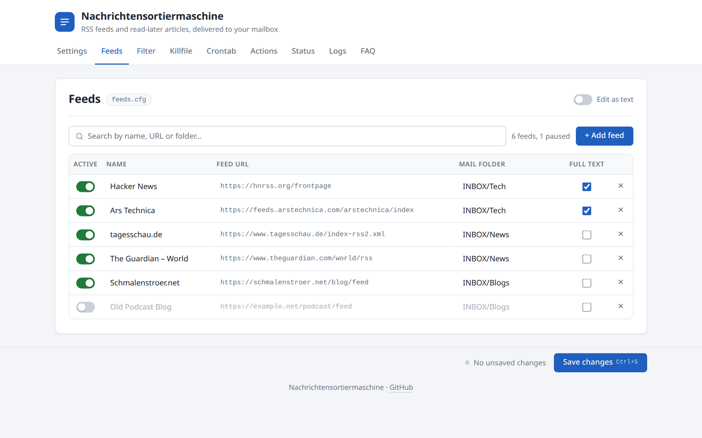
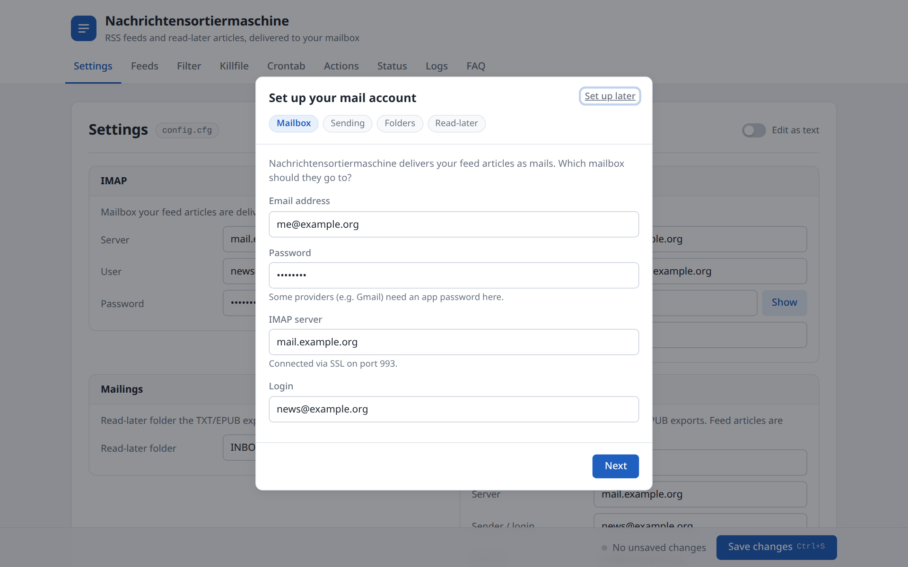
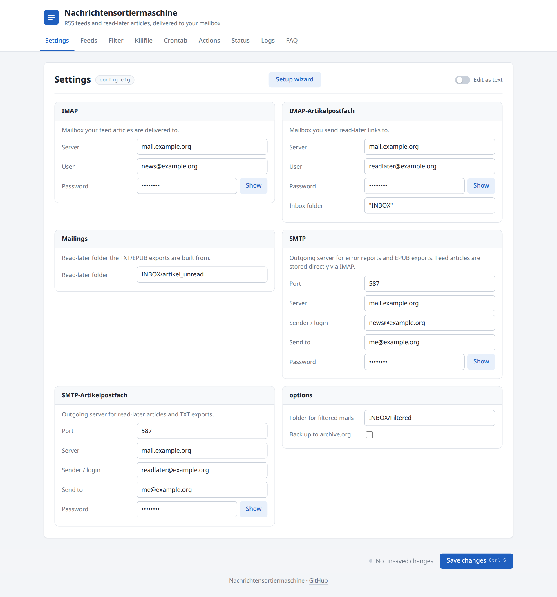
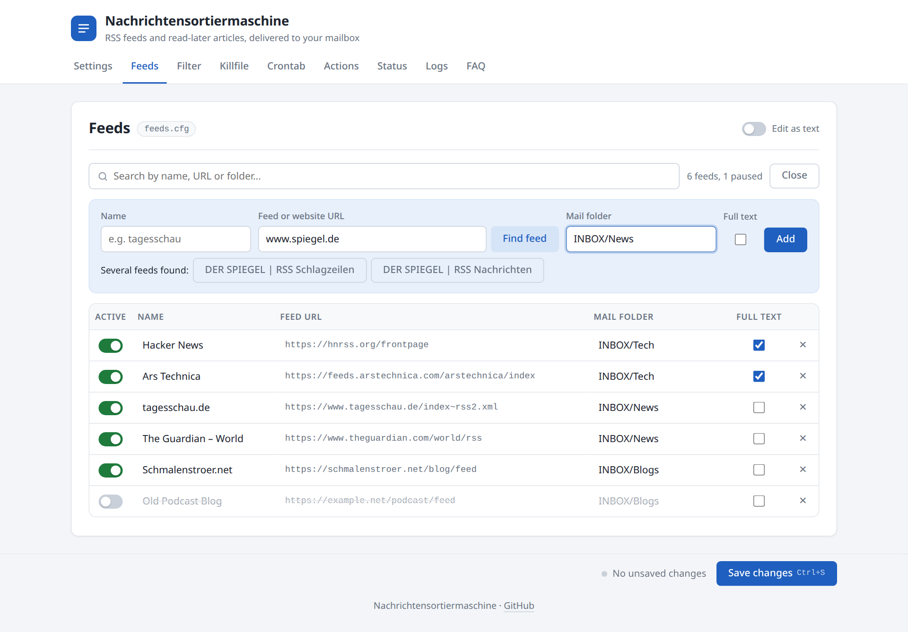
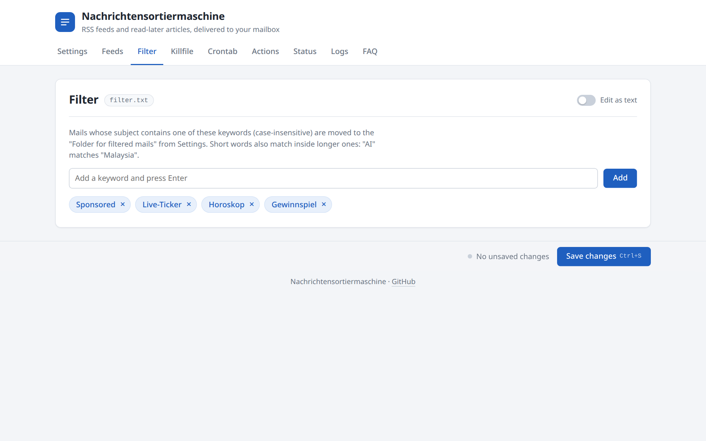
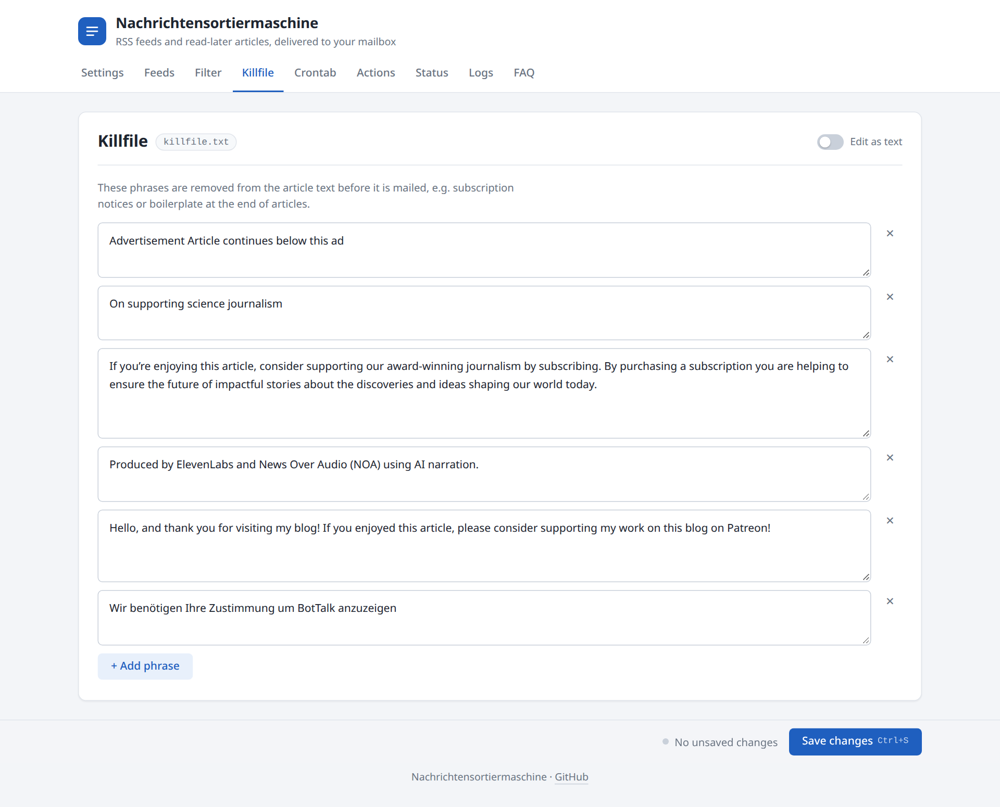
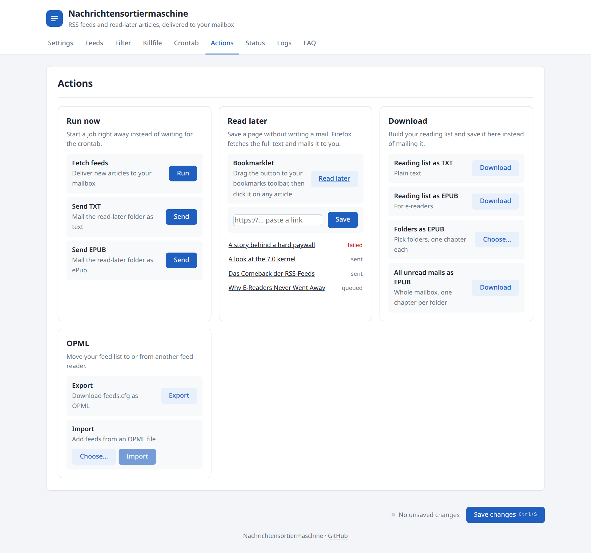
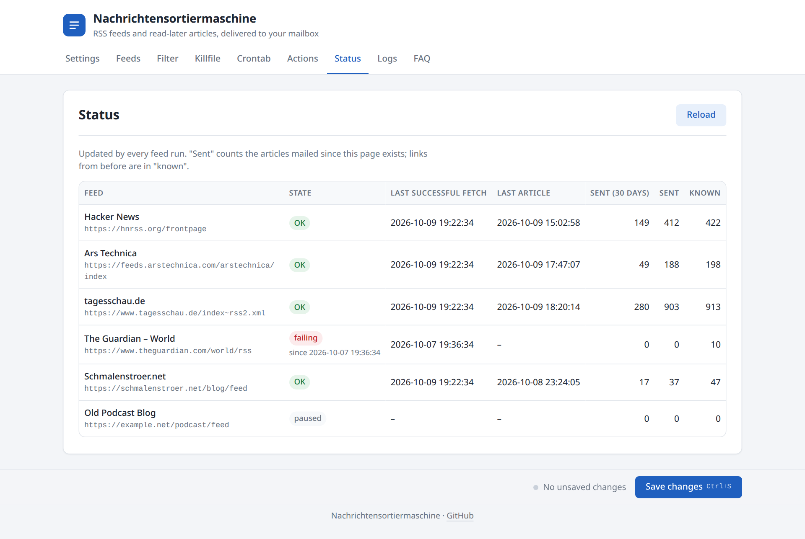
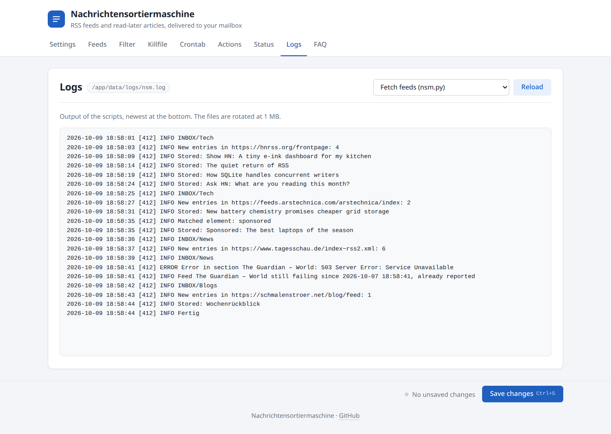
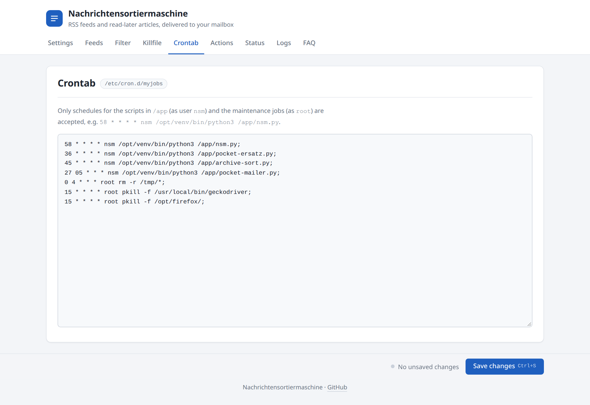

# Nachrichtensortiermaschine

**RSS feeds and read-later articles, delivered to your mailbox.**

Nachrichtensortiermaschine ("news sorting machine") turns your mail account into a feed reader. It checks your RSS and Atom feeds every hour and puts each new article into your mailbox as its own mail, sorted into a folder you choose. You read your news in the mail app you already use, on every device, offline too. You can also forward an article to someone, archive it or search it like any other mail.

It also replaces Pocket and Instapaper. Send it a link and it fetches the whole article and mails it to you. It can also turn your reading list into an EPUB for your e-reader.

Everything runs in one Docker container, and you manage it in a web interface.



---

## Features

### Feeds in your inbox
- **Each article is a mail.** New articles go straight into the IMAP folder you choose for that feed, e.g. `INBOX/Tech`, `INBOX/News` or `INBOX/Blogs`.
- **Full text for short feeds.** Some feeds only contain a teaser. For these, Nachrichtensortiermaschine loads the linked page and puts the full article into the mail.
- **No duplicates.** Each article is delivered once, even when it shows up again with tracking parameters added to its link. A feed you have just added only delivers its newest 10 articles.
- **Clean mails.** Scripts, tracking pixels and unsafe links are removed. Every mail starts with the title, the link and the word count.
- **Pause feeds** without deleting them.
- **Find feeds automatically.** Enter a website address and the program finds its RSS or Atom feed.
- **OPML import and export**, so you can move your feeds to or from another feed reader.
- **Missing mail folders are created** when you save your feeds.

### Filter and killfile
- **Filter:** Articles with one of your keywords in the title, e.g. "Sponsored" or "Horoskop", go to a separate folder instead of your feed folders.
- **Killfile:** Phrases that are cut out of every article, such as subscription ads, cookie notices or "Article continues below this ad". Small differences in wording still match.

### Read later (Pocket replacement)
There are three ways to save an article for later:
- **Bookmarklet:** Drag the button to your bookmarks bar and click it on any web page.
- **Paste a link** into the web interface.
- **Send a link by mail** to a separate read-later mailbox. This works from any device, including your phone's share menu.

The program then opens the page in a browser in the background. A cookie-banner blocker and a paywall bypass extension are installed in that browser. It extracts the article and mails you the full text. If a link fails, it is tried again up to three times. The web interface shows the state of each link.

### Reading lists for e-readers
- **EPUB:** The articles in your read-later folder become one e-book with a cover and a table of contents. It works well on Tolino and other e-ink readers.
- **More EPUB options:** Choose folders and get one chapter per folder, or get all unread mails of the whole mailbox.
- **Plain text:** The whole reading list as one `.txt` file.
- You can **send** these files to your mail address or **download** them in the web interface.

### Archive sorting
When you move a read article into the archive folder, Nachrichtensortiermaschine puts it back into its feed's folder. You can then find it again in the right place.

### Monitoring
- **Status page:** For each feed, it shows whether it works, when it was last fetched, its last article, and how many articles were delivered.
- **Error mails:** If a feed stops working, you get a mail. A feed that keeps failing is reported at most once a day.
- **Logs** of every job can be read in the browser.

### Web interface
- **Setup wizard:** Enter your mail account step by step. The wizard tests the login and creates the folders you need.
- You can change everything in forms, or switch to **Edit as text** if you prefer to edit the files directly.
- **Run any job now** instead of waiting for the schedule, and watch its output live.
- **Change the schedule** of each job in the Crontab tab.
- The interface is protected by a password.

---

## Screenshots

### Setup wizard
On first start, a wizard asks for your mail account and tests the connection.



### Settings
Mail accounts and folders. Passwords are hidden until you click "Show".



### Feeds
All feeds in one table: switch them on or off, pick a mail folder, turn on full text.


Add a feed by entering a website address. If the site has several feeds, you pick one.



### Filter
Keywords that move an article into the folder for filtered mails.



### Killfile
Phrases that are removed from every article.



### Actions
Run jobs now, save links for later, download reading lists, import or export OPML.



### Status
Shows whether each feed works and how many articles it delivered.



### Logs
The output of each job.



### Crontab
When each job runs.



---

## Requirements

- **A server or computer that runs Docker**, e.g. a home server, a NAS or a small VPS, with an x86-64 processor.
- **A mail account with IMAP and SMTP.** Use a separate account for Nachrichtensortiermaschine. If news shares a mailbox with your other mail, it gets messy fast. If you use Gmail with two-factor authentication, you need an app password.
- **Optional: a second mailbox for read-later links.** You only need it if you want to save links by sending them by mail. The bookmarklet and the web interface work without it.
- A mail app on the devices you read on. Any app works.

---

## Installation

### 1. Get the code and build the image

```bash
git clone https://github.com/michael-hatz/nachrichtensortiermaschine.git
cd nachrichtensortiermaschine
docker build -t nachrichtensortiermaschine -f dockerfile .
```

### 2. Start the container

```bash
docker run -d \
  --name nachrichtensortiermaschine \
  --restart unless-stopped \
  -p 5000:5000 \
  -v nsm-data:/app/data \
  -e NSM_WEB_PASSWORD=choose-a-password \
  nachrichtensortiermaschine
```

Or with Docker Compose:

```yaml
services:
  nsm:
    build:
      context: .
      dockerfile: dockerfile
    image: nachrichtensortiermaschine
    container_name: nachrichtensortiermaschine
    restart: unless-stopped
    ports:
      - "5000:5000"
    volumes:
      - ./data:/app/data
    environment:
      - NSM_WEB_PASSWORD=choose-a-password
```

Your settings, feeds, the article database and the logs are stored in the data volume (`/app/data`). They are kept when you update or recreate the container.

### 3. Open the web interface

Go to `http://<your-server>:5000` and log in as user **`admin`** with the password you set.

If you don't set `NSM_WEB_PASSWORD`, a random password is created on first start. You can find it in the container log (`docker logs nachrichtensortiermaschine`) and in `web-password.txt` in the data volume.

> **Accessing it from the internet?** Without HTTPS, the password is sent unencrypted. Put a reverse proxy with HTTPS in front of the container, e.g. Caddy, Traefik or nginx.

### 4. Set it up

1. The **setup wizard** opens automatically. Enter your mail account. It tests the login and creates the read-later folder and the filter folder.
2. Add your feeds in the **Feeds** tab, or import an OPML file from your old feed reader in the **Actions** tab.
3. Click **Save changes**.
4. Optional: in the **Actions** tab, drag the **Read later** bookmarklet to your bookmarks bar.

The first articles arrive at the next hourly run. To get them right away, go to **Actions → Fetch feeds → Run**.

### Updating

```bash
git pull
docker build -t nachrichtensortiermaschine -f dockerfile .
docker rm -f nachrichtensortiermaschine
# then start it again with the same "docker run" command as above
```

---

## Default schedule

| Job | When |
|---|---|
| Fetch feeds | every hour (at :58) |
| Read-later articles | every hour (at :36) |
| Archive sorting | every hour (at :45) |
| Reading list as text by mail | daily at 05:27 |
| Reading list as EPUB by mail | off, you can add it in the Crontab tab |

All times are German time (Europe/Berlin). You can change the schedule in the **Crontab** tab of the web interface.

---

## Tips

- **Use one folder per topic** (e.g. `INBOX/Tech`) instead of putting everything in the inbox. Your mail app then works like a feed reader with categories.
- **Be careful with short filter keywords.** "AI" also matches "Malaysia".
- **Mix feeds and newsletters.** Newsletters you subscribe to with the same address end up next to your feed articles.
- **Share an article** by forwarding the mail and adding a comment.
